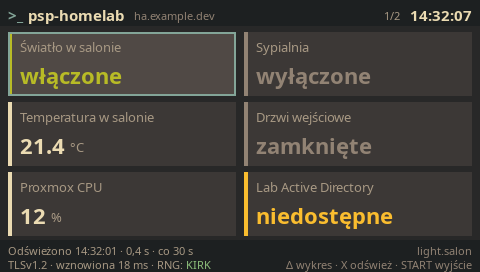
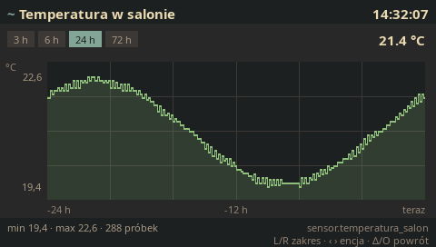

# psp-homelab

[Polski](README.md) · **English**

A Home Assistant status panel for the PSP. It connects over Wi-Fi, fetches the
state of selected entities over HTTPS (TLS 1.2, mbedTLS) and shows them as tiles
in Gruvbox colours. TLS keys are generated using the hardware random number
generator of the KIRK chip.

- can take the entity list straight from HA (a label or a group), no file editing
- history chart for any entity over the last 3, 6, 24 or 72 hours
- night mode: dims the screen backlight at night
- one-command install to the PSP over USB

The on-screen interface is in Polish.




## Requirements

- the [pspdev](https://github.com/pspdev/pspdev) toolchain in `~/pspdev` (mbedTLS 2.28, SDL2, SDL2_ttf, cJSON)
- for tests: the PPSSPP emulator (`sudo pacman -S ppsspp`), Python 3, openssl
- for a GUI preview on the computer: `sdl2`, `sdl2_ttf`, optionally ImageMagick
- on a real PSP: custom firmware (ARK-4) and a saved 2.4 GHz Wi-Fi network

## Building

```bash
./build.sh
```

Output in `build/`:

| File | What it is |
|---|---|
| `EBOOT.PBP` | the program (with embedded fonts and the public CA list) |
| `kirkrng.prx` | kernel module exposing the KIRK hardware random generator |
| `backlight.prx` | kernel module controlling backlight brightness (night mode) |

The public CA list is embedded from `/etc/ssl/certs/ca-certificates.crt`.

## Installing on the PSP

On the PSP choose Settings → USB Connection, plug in the cable and run:

```bash
tools/deploy.sh
```

The script rebuilds the program, finds the PSP's memory stick in
`/run/media/$USER/` and copies `EBOOT.PBP`, `kirkrng.prx` and `backlight.prx`
to `PSP/GAME/psp-homelab/`. It copies `config.ini` and `ca.pem` from the
project directory only if they are not on the card yet.

| Option | Effect |
|---|---|
| `--config` | also overwrite `config.ini` and `ca.pem` on the card |
| `--eject` | unmount the card after copying (you can unplug the cable right away) |
| `--target DIR` | root of the card when it is not under `/run/media` |
| `--no-build` | do not rebuild before copying |

Manually: copy `EBOOT.PBP`, both `.prx` files, `config.ini` (from
`config.example.ini`) and optionally `ca.pem` to `ms0:/PSP/GAME/psp-homelab/`.

Without `kirkrng.prx` the program works, but with a weaker randomness source;
the panel then shows "RNG: słaby" (weak). Without `backlight.prx` night mode
darkens the picture instead of the backlight (the backlight stays on).

## Configuration

| Key | Description |
|---|---|
| `host`, `port` | Home Assistant address; the name must match the certificate |
| `token` | long-lived access token, ideally of a non-admin user |
| `ca` | empty = public CAs; `ca.pem` = your own CA from a file next to `config.ini` |
| `refresh` | refresh interval in seconds (min. 5) |
| `wifi_profile` | number of the saved network on the PSP |
| `entity` | entity to display, repeatable; shown first |
| `entities_from` | entity list from HA: `label:psp` or a group, e.g. `light.psp`; repeatable (max. 8) |
| `night` | night mode hours, e.g. `22:00-07:00`; `off` disables it |
| `night_brightness` | brightness at night, 0–100 (default 10) |
| `night_wake` | how many seconds a button press brightens the screen at night (default 30) |
| `autoexit` | testing only: quit the program after N seconds |
| `test_chart` | testing only: open the chart of this entity after start |

At most 24 entities in total, 6 per page. Either `entity` or `entities_from` is required.

### Entity list from Home Assistant

Instead of listing entities in `config.ini`, mark them in HA and give the source:

- **Label** (`entities_from = label:psp`): in HA go to Settings → Areas,
  labels & zones → Labels, add `psp` and assign it to entities. The program
  asks for them via `POST /api/template`, which requires an **admin** token.
  With a regular user's token HA answers 401 and the bottom of the panel
  shows "Lista: … 401".
- **Group** (`entities_from = light.psp`): works with a non-admin token, which
  makes it the safer option. Settings → Devices & services → Helpers →
  Create helper → Group. Such a group combines entities of one type (lights,
  sensors, binary sensors, switches...), so for different types create several
  groups and list each on its own line:

  ```ini
  entities_from = light.psp
  entities_from = sensor.psp
  entities_from = binary_sensor.psp
  ```

  Any entity with an `entity_id` attribute works, including an old-style
  `group.psp` from `configuration.yaml`. An HA group of numeric sensors needs
  sensors with the same unit; sensors with different units are better added
  via `entity` or a label.

The list refreshes at start and every 10 minutes. Entities from `entity`
lines always come first, and duplicates are skipped.

### Night mode

During the `night` hours the screen dims to `night_brightness`. The first press
of any button only brightens the screen for `night_wake` seconds (it changes
nothing on the panel). On exit the brightness returns to its previous value.
Hours are in the PSP's local time (System Settings → Date & Time).

`config.ini` contains the token and is in `.gitignore`.

## Controls

| Button | Action |
|---|---|
| D-pad | select a tile |
| L / R | previous / next page |
| △ | history chart of the selected entity |
| X | refresh now |
| START | quit |

On the chart: L / R changes the range (3, 6, 24, 72 h), left / right moves
to the neighbouring entity, △ or O returns to the tiles. Numbers are averaged
to 200 points; on/off states (lights, doors) are drawn as steps, and every
switch-on is visible, even a short one.

## Tests

### Mock Home Assistant

```bash
tools/make_test_ca.sh /tmp/testca
tools/mock_ha.py --cert /tmp/testca/server.pem --key /tmp/testca/server.key \
    --token test-token --close-after 4
```

The mock also knows the `psp` label, the groups `group.psp` and `light.psp`,
and returns fake history (`/api/history/period`). `--template-admin-only`
rejects `/api/template` with 401, like HA does for a non-admin token.

The mock listens on `https://localhost:8123`. Put `EBOOT.PBP`, `kirkrng.prx`,
`ca.pem` from `/tmp/testca` and a `config.ini` with `host = localhost`,
`port = 8123`, `token = test-token`, `ca = ca.pem` in a test directory. Then:

```bash
PPSSPPSDL test-dir/EBOOT.PBP
```

Enable networking in PPSSPP: Settings → Networking. `--close-after 4` closes
the connection every 4 requests, so TLS session resumption is visible.

`PPSSPPHeadless -l` prints the start sequence and every refresh to the log
(`[start]`, `[refresh]`, `[lista]`, `[wykres]`, `[noc]`). Note: headless mode
speeds up emulated time while host networking runs in real time, so refresh
timings come out inflated there.

### Logic tests

```bash
tools/test/run.sh
```

Checks ISO date parsing, chart buckets and the night mode window on the computer.

### GUI preview on the computer

```bash
tools/preview/build.sh
```

Compiles `src/ui.c` for the computer and saves sample screens to
`build/preview/*.png`, without an emulator.

## How it works

| File | Role |
|---|---|
| `src/main.c` | SDL2 window, UI loop, buttons |
| `src/ui.c` | drawing: start screen, tiles, status bars, text texture cache |
| `src/worker.c` | worker thread: Wi-Fi, TLS, refreshing; the GUI never waits on the network |
| `src/https.c` | HTTPS client: certificate and hostname (SNI) verification, keep-alive, session resumption |
| `src/ha.c` | entity states, list from a label/group, history; JSON (cJSON) |
| `src/chart.c` | averaging history into chart buckets |
| `src/timeutil.c` | UTC time from the PSP clock, ISO 8601 dates |
| `src/night.c` | night mode: hours, wake on button, brightness |
| `src/rng.c`, `src/kmod.c` | loading the kernel modules and testing the generator |
| `kirkrng/` | kernel module: KIRK command 0xE (PRNG) exposed to user mode |
| `backlight/` | kernel module: `sceDisplaySetBrightness` from `sceDisplay_driver` |
| `tools/deploy.sh` | installing to the PSP over USB |
| `src/config.c`, `src/net.c` | `config.ini`, Wi-Fi |

Randomness for mbedTLS: KIRK as the "strong" source plus clock jitter as an
additional "weak" one. The default `getentropy()` in pspdev (a Mersenne
Twister seeded with the time) is not used as the only source.

## Known limitations and pitfalls

- **Linking**: do not add `pspnet_inet`, `pspnet_resolver`, `psputility`
  or `psprtc` (added by `psp-gcc`), nor `pspdisplay`, `pspge`, `pspctrl`
  (added by SDL2) to `target_link_libraries`. Linking them twice splits the
  import table; the symptom is a `psp-fixup-imports` warning
  "stubs out of order", and on the PSP some functions do not get resolved.
- **Backlight**: `backlight.prx` uses the old pspsdk NID of
  `sceDisplaySetBrightness`. ARK-4 should translate it for firmware 6.61,
  but this has not been checked on hardware. If it does not work, remove
  `backlight.prx` from the card and night mode will darken the picture instead.
- **72 h history** for a sensor updated every few seconds is several hundred KB
  of JSON; on the PSP it takes a few seconds to load (the response limit is 2 MB).
- **Threads**: on the PSP, threads of equal priority do not preempt each other.
  The network thread has a higher priority than the GUI, and the TLS wait loops
  yield the CPU (`sceKernelDelayThread`); otherwise they starve the system's
  network threads.
- **KIRK in the emulator**: PPSSPP emulates the PRNG command, so the test
  passes, but real randomness quality only applies to hardware.
- badssl.com servers do not answer the ClientHello in PPSSPP (they work from
  the computer). Cloudflare, example.com and the mock work. Not explained.
- **Not yet tested on a real PSP.**

## License

Code: MIT (see `LICENSE`). Noto Sans fonts in `assets/fonts/`: SIL Open Font
License 1.1, see `assets/fonts/README.md`.
