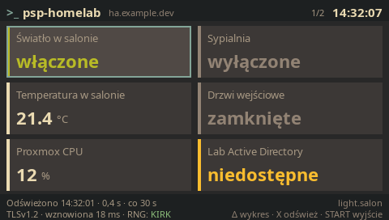
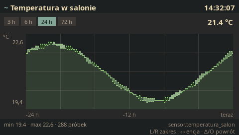

# psp-homelab

**Polski** · [English](README.en.md)

Panel stanu Home Assistant na PSP. Łączy się przez Wi-Fi, pobiera stany wybranych
encji przez HTTPS (TLS 1.2, mbedTLS) i pokazuje je jako kafelki w kolorach Gruvbox.
Klucze TLS powstają z użyciem sprzętowego generatora liczb losowych układu KIRK.

- listę encji może brać prosto z HA (etykieta albo grupa), bez edycji pliku
- wykres historii dowolnej encji z ostatnich 3, 6, 24 lub 72 godzin
- tryb nocny: w nocy przygasza podświetlenie ekranu
- wgrywanie na PSP jedną komendą przez USB




## Wymagania

- toolchain [pspdev](https://github.com/pspdev/pspdev) w `~/pspdev` (mbedTLS 2.28, SDL2, SDL2_ttf, cJSON)
- do testów: emulator PPSSPP (`sudo pacman -S ppsspp`), Python 3, openssl
- do podglądu GUI na komputerze: `sdl2`, `sdl2_ttf`, opcjonalnie ImageMagick
- na prawdziwym PSP: custom firmware (ARK-4) i zapisana sieć Wi-Fi 2.4 GHz

## Budowanie

```bash
./build.sh
```

Wynik w `build/`:

| Plik | Co to |
|---|---|
| `EBOOT.PBP` | program (z wbudowanymi czcionkami i listą publicznych CA) |
| `kirkrng.prx` | moduł jądra ze sprzętowym generatorem losowym KIRK |
| `backlight.prx` | moduł jądra sterujący jasnością podświetlenia (tryb nocny) |

Lista publicznych CA jest wbudowywana z `/etc/ssl/certs/ca-certificates.crt`.

## Instalacja na PSP

Na PSP wybierz Ustawienia → Połączenie USB, podłącz kabel i uruchom:

```bash
tools/deploy.sh
```

Skrypt przebudowuje program, znajduje kartę PSP w `/run/media/$USER/`
i kopiuje do `PSP/GAME/psp-homelab/` pliki `EBOOT.PBP`, `kirkrng.prx`
i `backlight.prx`. `config.ini` i `ca.pem` z katalogu projektu kopiuje
tylko wtedy, gdy na karcie ich jeszcze nie ma.

| Opcja | Działanie |
|---|---|
| `--config` | nadpisz też `config.ini` i `ca.pem` na karcie |
| `--eject` | odmontuj kartę po skopiowaniu (można od razu odłączyć kabel) |
| `--target DIR` | katalog główny karty, gdy nie jest w `/run/media` |
| `--no-build` | nie przebudowuj przed kopiowaniem |

Ręcznie: do `ms0:/PSP/GAME/psp-homelab/` skopiuj `EBOOT.PBP`, oba pliki
`.prx`, `config.ini` (z `config.example.ini`) i ewentualnie `ca.pem`.

Bez `kirkrng.prx` program działa, ale z gorszym źródłem losowości;
panel pokazuje wtedy „RNG: słaby”. Bez `backlight.prx` tryb nocny
przyciemnia sam obraz zamiast podświetlenia (podświetlenie dalej świeci).

## Konfiguracja

| Klucz | Opis |
|---|---|
| `host`, `port` | adres Home Assistant; nazwa musi pasować do certyfikatu |
| `token` | token długoterminowy, najlepiej użytkownika bez uprawnień administratora |
| `ca` | puste = publiczne CA; `ca.pem` = własne CA z pliku obok `config.ini` |
| `refresh` | co ile sekund odświeżać (min. 5) |
| `wifi_profile` | numer zapisanej sieci na PSP |
| `entity` | encja do wyświetlenia, powtarzane; pokazywane pierwsze |
| `entities_from` | lista encji z HA: `label:psp` albo grupa, np. `light.psp`; powtarzane (maks. 8) |
| `night` | godziny trybu nocnego, np. `22:00-07:00`; `off` wyłącza |
| `night_brightness` | jasność w nocy, 0–100 (domyślnie 10) |
| `night_wake` | na ile sekund przycisk rozjaśnia ekran w nocy (domyślnie 30) |
| `autoexit` | tylko do testów: zamknij program po N sekundach |
| `test_chart` | tylko do testów: po starcie otwórz wykres tej encji |

Razem maks. 24 encje, po 6 na stronę. Wymagane jest `entity` albo `entities_from`.

### Lista encji z Home Assistant

Zamiast wpisywać encje do `config.ini`, oznacz je w HA i podaj źródło:

- **Etykieta** (`entities_from = label:psp`): w HA Ustawienia → Obszary,
  etykiety i strefy → Etykiety, dodaj `psp` i nadaj ją encjom. Program pyta
  o nie przez `POST /api/template`, a to wymaga tokenu **administratora**.
  Z tokenem zwykłego użytkownika HA odpowie 401 i na dole panelu pojawi się
  „Lista: … 401”.
- **Grupa** (`entities_from = light.psp`): działa z tokenem bez uprawnień
  administratora, dlatego jest bezpieczniejszą opcją. Ustawienia → Urządzenia
  i usługi → Pomocnicy → Utwórz pomocnika → Grupa. Taka grupa łączy encje
  jednego typu (światła, czujniki, czujniki binarne, przełączniki...), więc
  dla różnych typów zrób kilka grup i podaj każdą w osobnej linii:

  ```ini
  entities_from = light.psp
  entities_from = sensor.psp
  entities_from = binary_sensor.psp
  ```

  Działa każda encja z atrybutem `entity_id`, także stara grupa `group.psp`
  z `configuration.yaml`. Grupa czujników liczbowych w HA wymaga czujników
  z tą samą jednostką; czujniki z różnymi jednostkami lepiej dodać przez
  `entity` albo etykietę.

Lista odświeża się przy starcie i co 10 minut. Encje z linii `entity` są
zawsze pierwsze, a powtórzenia są pomijane.

### Tryb nocny

W godzinach z `night` ekran przygasa do `night_brightness`. Pierwsze naciśnięcie
dowolnego przycisku tylko rozjaśnia ekran na `night_wake` sekund (niczego nie
zmienia na panelu). Po wyjściu z programu jasność wraca do poprzedniej.
Godziny są w czasie lokalnym PSP (Ustawienia systemu → Data i czas).

`config.ini` zawiera token i jest w `.gitignore`.

## Sterowanie

| Przycisk | Działanie |
|---|---|
| D-pad | wybór kafelka |
| L / R | poprzednia / następna strona |
| △ | wykres historii zaznaczonej encji |
| X | odśwież teraz |
| START | wyjście |

Na wykresie: L / R zmienia zakres (3, 6, 24, 72 h), lewo / prawo przechodzi
do sąsiedniej encji, △ albo O wraca do kafelków. Liczby są uśredniane do
200 punktów; stany wł./wył. (światła, drzwi) rysowane są jako schodki,
a każde włączenie jest widoczne, nawet krótkie.

## Testy

### Atrapa Home Assistant

```bash
tools/make_test_ca.sh /tmp/testca
tools/mock_ha.py --cert /tmp/testca/server.pem --key /tmp/testca/server.key \
    --token test-token --close-after 4
```

Atrapa zna też etykietę `psp`, grupy `group.psp` i `light.psp` oraz zwraca sztuczną historię
(`/api/history/period`). `--template-admin-only` odrzuca `/api/template`
kodem 401, jak HA dla tokenu bez uprawnień administratora.

Atrapa słucha na `https://localhost:8123`. W katalogu testowym połóż
`EBOOT.PBP`, `kirkrng.prx`, `ca.pem` z `/tmp/testca` i `config.ini` z
`host = localhost`, `port = 8123`, `token = test-token`, `ca = ca.pem`. Potem:

```bash
PPSSPPSDL katalog-testowy/EBOOT.PBP
```

W PPSSPP włącz sieć: Ustawienia → Sieć. `--close-after 4` zamyka połączenie
co 4 żądania, żeby było widać wznawianie sesji TLS.

`PPSSPPHeadless -l` wypisuje w logu przebieg startu i każde odświeżanie
(`[start]`, `[refresh]`, `[lista]`, `[wykres]`, `[noc]`). Uwaga: headless przyspiesza czas emulowany, a sieć
hosta działa w czasie rzeczywistym, więc czasy odświeżania wychodzą tam zawyżone.

### Testy logiki

```bash
tools/test/run.sh
```

Sprawdza na komputerze parsowanie dat ISO, kubełki wykresu i okno trybu nocnego.

### Podgląd GUI na komputerze

```bash
tools/preview/build.sh
```

Kompiluje `src/ui.c` na komputer i zapisuje przykładowe ekrany do
`build/preview/*.png`, bez emulatora.

## Jak to działa

| Plik | Rola |
|---|---|
| `src/main.c` | okno SDL2, pętla interfejsu, przyciski |
| `src/ui.c` | rysowanie: ekran startowy, kafelki, paski stanu, cache tekstur z tekstem |
| `src/worker.c` | wątek roboczy: Wi-Fi, TLS, odświeżanie; GUI nigdy nie czeka na sieć |
| `src/https.c` | klient HTTPS: weryfikacja certyfikatu i nazwy (SNI), keep-alive, wznawianie sesji |
| `src/ha.c` | stany encji, lista z etykiety/grupy, historia; JSON (cJSON) |
| `src/chart.c` | uśrednianie historii do kubełków wykresu |
| `src/timeutil.c` | czas UTC z zegara PSP, daty ISO 8601 |
| `src/night.c` | tryb nocny: godziny, budzenie przyciskiem, jasność |
| `src/rng.c`, `src/kmod.c` | wczytanie modułów jądra i test generatora |
| `kirkrng/` | moduł jądra: polecenie KIRK 0xE (PRNG) udostępnione trybowi użytkownika |
| `backlight/` | moduł jądra: `sceDisplaySetBrightness` z `sceDisplay_driver` |
| `tools/deploy.sh` | wgrywanie na PSP przez USB |
| `src/config.c`, `src/net.c` | `config.ini`, Wi-Fi |

Losowość dla mbedTLS: KIRK jako źródło „silne” plus drgania zegara jako
dodatkowe „słabe”. Domyślne `getentropy()` w pspdev (Mersenne Twister zasiany
czasem) nie jest używane jako jedyne źródło.

## Znane ograniczenia i pułapki

- **Linkowanie**: nie dodawaj `pspnet_inet`, `pspnet_resolver`, `psputility`
  ani `psprtc` (dodaje je `psp-gcc`), ani `pspdisplay`, `pspge`, `pspctrl`
  (dodaje je SDL2) do `target_link_libraries`. Podwójne linkowanie rozdziela
  tablicę importów; objawem jest ostrzeżenie `psp-fixup-imports`
  „stubs out of order”, a na PSP część funkcji nie zostaje podpięta.
- **Podświetlenie**: `backlight.prx` używa starego NID funkcji
  `sceDisplaySetBrightness` z pspsdk. ARK-4 powinien go przetłumaczyć na
  firmware 6.61, ale nie zostało to sprawdzone na sprzęcie. Gdyby nie działało,
  usuń `backlight.prx` z karty, a tryb nocny będzie przyciemniał obraz.
- **Historia z 72 h** dla czujnika odświeżanego co kilka sekund to kilkaset KB
  JSON-a; na PSP wczytuje się kilka sekund (limit odpowiedzi to 2 MB).
- **Wątki**: na PSP wątki o równym priorytecie nie wywłaszczają się. Wątek
  sieciowy ma wyższy priorytet niż GUI, a pętle oczekiwania TLS oddają procesor
  (`sceKernelDelayThread`), inaczej zagładzają wątki sieciowe systemu.
- **KIRK w emulatorze**: PPSSPP emuluje polecenie PRNG, więc test przechodzi,
  ale prawdziwa jakość losowości dotyczy tylko sprzętu.
- Serwery badssl.com nie odpowiadają w PPSSPP na ClientHello (z komputera
  działają). Cloudflare, example.com i atrapa działają. Nie wyjaśnione.
- **Nie testowane jeszcze na prawdziwym PSP.**

## Licencja

Kod: MIT (plik `LICENSE`). Czcionki Noto Sans w `assets/fonts/`: SIL Open Font
License 1.1, patrz `assets/fonts/README.md`.
